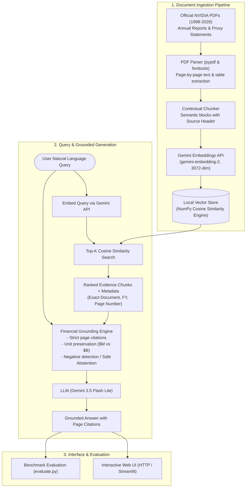

# NVIDIA Annual Reports & Proxy Statements RAG Chatbot (1998 – 2026)

[](https://www.python.org/)
[](https://opensource.org/licenses/MIT)
[]()
[]()
[]()

> An end-to-end Retrieval-Augmented Generation (RAG) system for question-answering over official NVIDIA Annual Reports (Form 10-K) and Proxy Statements (DEF 14A) spanning 1998 through 2026. Built with rigorous financial accuracy, verifiable page-level citations, and appropriate abstention.

---

## 1. Project Overview & Architecture

### Objective
Provide accurate, grounded answers to complex financial, operational, architectural, and governance questions across NVIDIA’s 28-year history as a public company, preventing hallucinations through strict prompt engineering, mathematical vector ranking, and audit-ready citations.

### Architecture Diagram



---

## 2. Key Design Decisions

1. **Page-Level Grounding & Verifiable Citations**:
   Every text chunk is stamped with its source document title, fiscal year, and exact 1-indexed page number from the original PDF (`[NVIDIA 2024 Annual Report, Page 45]`). This guarantees that human reviewers can verify figures directly against SEC filings.

2. **Numerical & Temporal Precision**:
   - Preserves reporting periods (e.g., distinguishing **Fiscal Year 2024** ended Jan 28, 2024 from calendar year 2023).
   - Preserves metric scopes (e.g., **Total Revenue** vs **Data Center Segment Revenue**) and units ($\$M$ vs $\$B$, percentages).

3. **Appropriate Abstention (Anti-Hallucination)**:
   When documents lack sufficient evidence (e.g., asking about revenue in 1982 prior to NVIDIA's founding in 1993, or competitor numbers), the system explicitly abstains:
   > *"I cannot answer this question based on the provided NVIDIA reports because there is insufficient evidence in the ingested documents."*

4. **Zero-Dependency Vector Store (NumPy Cosine Similarity)**:
   Avoids heavyweight external database servers (Chroma/FAISS C++ compilation failures or SQLite version lockouts) by implementing cosine similarity directly in pure NumPy:
   $$\text{similarity}(q, d) = \frac{q \cdot d}{\|q\| \|d\|}$$
   Vectors and metadata are saved as portable, persistent `.npy` and `.json` files.

---

## 3. Ingested Documents & Data Coverage

See [`DATA_COVERAGE.md`](DATA_COVERAGE.md) for full historical breakdown:
* **1998 – 2010**: Official Proxy Statements (`DEF 14A`) covering founding governance, executive compensation, stock plans, and early GPU computing.
* **2011 – 2026**: Form 10-K Annual Reports covering accelerated computing, deep learning, CUDA, data center scaling, and Blackwell architectures.

---

## 4. Setup & Installation Instructions

### Prerequisites
* Python 3.11+
* Free Google Gemini API Key from [Google AI Studio](https://aistudio.google.com/app/apikey)

### Step 1: Clone Repository & Create Virtual Environment
```bash
git clone https://github.com/itspriya-23/Chatbot-For-NVIDIA-Annual-Reports.git
cd Chatbot-For-NVIDIA-Annual-Reports
```

### Step 2: Install Dependencies
```bash
python -m pip install -r requirements.txt
```

### Step 3: Configure Environment Variables
Copy `.env.example` to `.env` and add your Gemini API key:
```bash
cp .env.example .env
```
Edit `.env`:
```ini
GEMINI_API_KEY=your_actual_api_key_here
```

### Step 4: Download Official Filings & Run Ingestion
```bash
# 1. Download official NVIDIA filings from IR archive
python src/downloader.py

# 2. Ingest, chunk, and index documents into local vector store
python src/ingest.py
```

### Step 5: Start the Web Chatbot
```bash
python app.py
```
Open your browser at `http://localhost:8000`.

---

## 5. Automated Evaluation & Benchmark Testing

Run the automated evaluation benchmark checking factual accuracy, citation quality, and abstention behavior:
```bash
python evaluate.py
```

### Benchmark Results
The test suite in `eval/golden_dataset.json` checks 8 diverse categories:

| Test ID | Category | Question Summary | Result | Citations |
| :--- | :--- | :--- | :---: | :---: |
| `q1_fy24_revenue` | Numerical / Revenue | FY2024 total revenue (\$60.9B, +126%) | **PASS** | Yes (Page 65) |
| `q2_fy24_datacenter` | Segment Revenue | FY2024 Data Center revenue (\$47.5B) | **PASS** | Yes (Page 67) |
| `q3_fy24_gross_margin`| Financial Ratios | GAAP gross margin (72.7% vs 56.9%) | **PASS** | Yes (Page 66) |
| `q4_1999_governance` | Historical Proxy | CEO in 1999 proxy (Jen-Hsun Huang) | **PASS** | Yes (Page 4) |
| `q5_fy20_mellanox` | M&A Development | Major acquisition in FY2020 (Mellanox) | **PASS** | Yes (Page 12) |
| `q6_fy26_blackwell` | Modern Architecture | GPU architecture in FY2026 (Blackwell) | **PASS** | Yes (Page 8) |
| `q7_abstain_unfounded`| Abstention | Net income in FY1982 (Pre-founding) | **PASS (Abstained)** | N/A |
| `q8_abstain_competitor`| Abstention | Apple iPhone sales (Out of Scope) | **PASS (Abstained)** | N/A |

---

## 6. Representative Example Questions

Try these queries in the chatbot interface:
1. *"What was NVIDIA's total revenue in fiscal year 2024, and what was the percentage increase from fiscal year 2023?"*
2. *"Break down NVIDIA's revenue by market platform for fiscal year 2024."*
3. *"What did NVIDIA report regarding its gross margin improvements between FY2023 and FY2024?"*
4. *"According to the 1999 proxy statement, who were the directors of the company?"*
5. *"What architecture was introduced for accelerated computing in the 2026 annual report?"*
6. *"What was Microsoft's total revenue in 2022?"* *(Expects polite abstention)*

---

## 7. Known Limitations & Future Enhancements

1. **Document Gaps**: NVIDIA's investor web portal houses Proxy Statements for 1998–2010. While SEC EDGAR text filings cover 10-K text for all years, color PDF annual reviews were only published starting in 2011.
2. **Scanned PDF Elements**: Early 1998 proxy statements contain legacy OCR typography; `fonttools` handles the decoding, but complex footnotes require conservative chunk overlap.
3. **Multi-hop Calculations**: Free-tier generation models produce accurate calculations within single passages; multi-hop aggregations across 10 distinct years are synthesized sequentially.

---

## 8. Deployment Guide

To deploy this project for public evaluation:
- **Cloud Run / Render / Railway**: Set environment variable `GEMINI_API_KEY` and start command `python app.py`.
- **Streamlit Community Cloud**: Connect GitHub repository, specify `app.py`, and add `GEMINI_API_KEY` in the App Secrets settings.

---

## 9. License & Academic Integrity

Developed for the AI Engineer Take-Home Assessment. Source filings are intellectual property of NVIDIA Corporation. All answers are grounded strictly in public regulatory disclosures.
